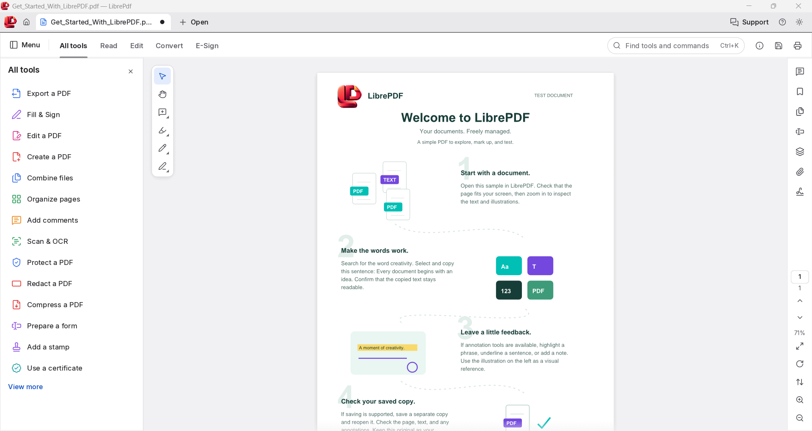
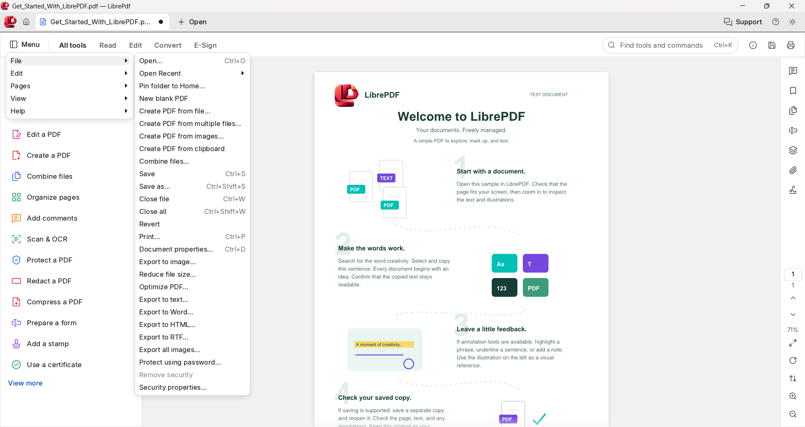
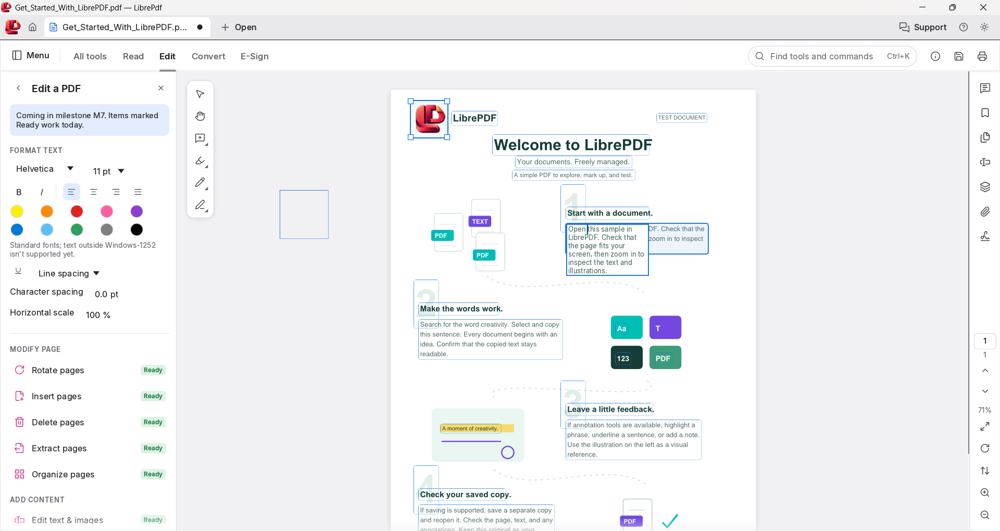
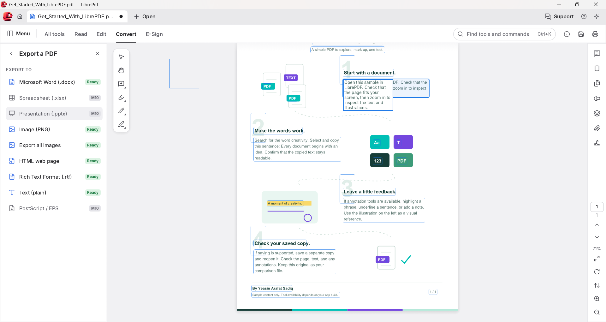
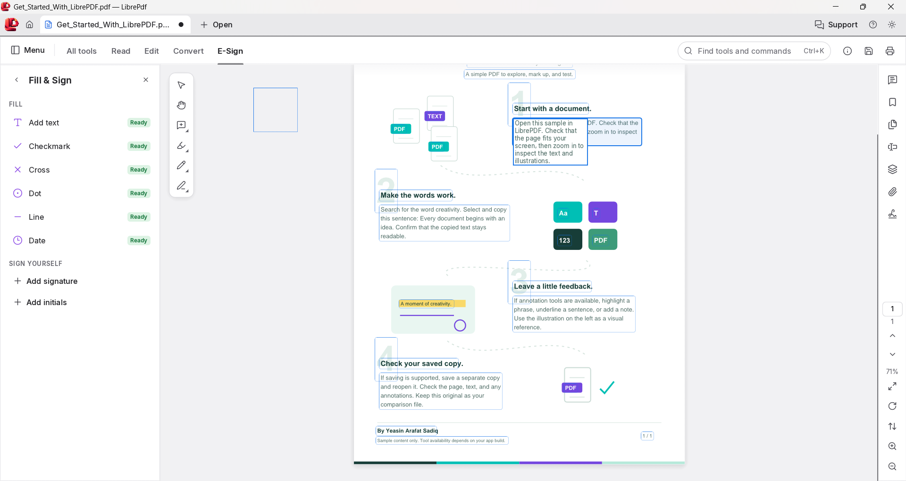
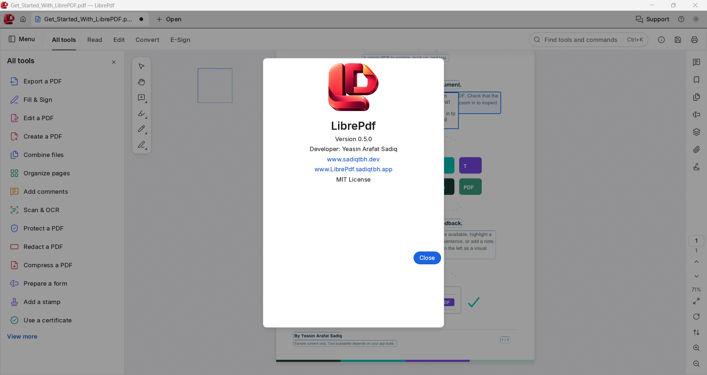

<div align="center">


# LibrePDF

### Your documents. Freely managed.
**A modern, lightweight, 100% offline PDF workspace for reading, organizing, filling, and exporting documents on Windows.**

[-0078D6?style=for-the-badge&logo=windows&logoColor=white)](https://www.librepdf.sadiqtbh.app/)
[](https://github.com/sadiqtbh/Librepdf/releases)
[](LICENSE)
[](https://www.librepdf.sadiqtbh.app/)
[](https://www.librepix.sadiqtbh.app/)

<br/>

### 🌐 Direct Download Portal: [**librepdf.sadiqtbh.app**](https://www.librepdf.sadiqtbh.app/)

[**Download Windows Installer (.msi)**](https://github.com/sadiqtbh/Librepdf/releases/download/v0.5.0/LibrePDF-0.5.0.msi) &nbsp;•&nbsp; [**Media & Screenshot Kit (.zip)**](https://github.com/sadiqtbh/Librepdf/releases/download/v0.5.0/LibrePDF-Screenshots.zip) &nbsp;•&nbsp; [**Official Web Portal**](https://www.librepdf.sadiqtbh.app/) &nbsp;•&nbsp; [**Try LibrePix Image Editor**](https://www.librepix.sadiqtbh.app/)

</div>

---

## 🌟 Overview

A PDF can be something to read, a set of pages to organize, or a legal contract waiting for crucial details. **LibrePDF** unites these workflows into a unified, high-performance desktop workspace featuring document tabs, fluid zoom navigation, surgical page organization, multi-format export, and digital form fill-out tools.

Designed from the ground up for Windows, **LibrePDF** processes all documents strictly inside local system memory with zero cloud uploads, zero account requirements, and zero subscription paywalls.

---

## 📸 Application Visual Showcase ([Official Web Walkthrough](https://www.librepdf.sadiqtbh.app/))

<div align="center">

### 1. Unified Reading Workspace & Navigation
*Clean tabbed document interface featuring thumbnail preview, full-width zoom, page jumper, and rapid tool search.*


<br/><br/>

### 2. Comprehensive File Management
*Integrated File menu with rapid keyboard shortcuts (Ctrl+O to open, Ctrl+S to save, Ctrl+P to print), recent file history, and new PDF generation.*


<br/><br/>

### 3. Surgical Page Organization & Rotation
*Rotate clockwise/counterclockwise, insert new leaves, extract selections, delete unwanted sheets, and reorder document structures.*


<br/><br/>

### 4. Versatile Content Export Suite
*Convert and export documents into Microsoft Word (`.docx`), lossless PNG, extracted raw images, HTML, RTF, and plain text formats.*


<br/><br/>

### 5. Fill & Sign Precision Controls
*Fill out PDF forms with text annotations, checkmarks, crosses, bullet dots, separator lines, and date stamps; place initial and signature marks.*


<br/><br/>

### 6. Official About Dialog & MIT License
*Certified version 0.5.0 identifying author Yeasin Arafat Sadiq, open-source MIT License terms, and official project links.*


</div>

---

## ✨ Key Superpowers

- 📖 **Tabbed Document Multi-Tasking**: Open multiple PDFs concurrently across separate tabs without clunky window hopping.
- 📑 **Comprehensive Page Operations**: One-click page rotation, extraction of custom page ranges, splitting, and merging.
- 🔄 **Multi-Format Document Export**: Export to editable Microsoft Word (`.docx`), HTML, RTF, plain text, or render page ranges to crisp PNG graphics.
- ✍️ **Fill & Sign Annotations**: Easily fill checkboxes, mark approvals with tick/cross markers, stamp dates, and append digital signatures.
- 🔍 **Instant In-Document Tool Search**: Quick command palette to locate tools, actions, and features instantly.
- 🔒 **100% Offline & Private**: Zero background analytics, zero telemetry, and zero network dependencies. Your contracts and files never leave your device.
- 🆓 **Free & Open Source Forever**: Licensed under the permissive MIT License with zero recurring fees.

---

## 📦 Downloads & Packages

| Package File | Platform | Architecture | Size | Description | Link |
| :--- | :--- | :---: | :---: | :--- | :--- |
| **`LibrePDF-0.5.0.msi`** | Windows 10 / 11 | x64 | ~75.5 MB | **Official Windows Installer** with start menu integration & shortcut | [Download](https://github.com/sadiqtbh/Librepdf/releases/download/v0.5.0/LibrePDF-0.5.0.msi) |
| **`LibrePDF-Screenshots.zip`** | All Platforms | Independent | ~1.4 MB | Full-resolution press & media screenshot showcase package | [Download](https://github.com/sadiqtbh/Librepdf/releases/download/v0.5.0/LibrePDF-Screenshots.zip) |
| **Official Web Mirror** | Web Portal | Browser | — | Cloudflare-accelerated direct web installer portal | [librepdf.sadiqtbh.app](https://www.librepdf.sadiqtbh.app/) |

### Cryptographic Checksum (SHA-256)
```text
File:   LibrePDF-0.5.0.msi
SHA256: 6C392FB8E6441E4CE20BE953B6734FAA00CC6F7515520DB912F250458F612C08
```

---

## ⚡ What's in Version 0.5.0

- **Multi-Tab Reading View**: Smooth document navigation, continuous page zoom, and interactive sidebar controls.
- **Ready Page Tools**: Verified in-app tools for page rotation, insertion, deletion, extraction, and rearrangement.
- **Ready Export Pipeline**: Full support for `.docx`, `.png`, image extraction, `.html`, `.rtf`, and `.txt` conversions.
- **Ready Fill & Sign Engine**: Quick annotation stamps for legal, tax, and registration form completions.
- **Clean Windows Installer**: Certified `.msi` setup package with silent deployment capabilities.

---

## 🎨 Companion Application

Check out **[LibrePix](https://github.com/sadiqtbh/Librepix)** ([librepix.sadiqtbh.app](https://www.librepix.sadiqtbh.app/)) — the free, open-source companion raster image editor for Windows featuring professional layer stacks, curves, color grading, and native PSD compatibility.

---

## 👨‍💻 Developer & Attribution

Developed with passion by **Yeasin Arafat Sadiq**  
🌐 **Official Website**: [https://www.librepdf.sadiqtbh.app/](https://www.librepdf.sadiqtbh.app/)  
👨‍💻 **Developer Portfolio**: [https://www.sadiqtbh.dev](https://www.sadiqtbh.dev)  
🐙 **GitHub Profile**: [@sadiqtbh](https://github.com/sadiqtbh)  
🎨 **Companion Project**: [LibrePix](https://github.com/sadiqtbh/Librepix)
